# Smart Performance Analyzer

A full-stack student performance management application built with **React, Spring Boot, Oracle Database, and Hugging Face AI**. It helps educators manage student records, calculate academic performance using deterministic business rules, identify students who may need support, and generate practical recommendations.

> **Portfolio project:** This repository demonstrates full-stack development, REST API design, Oracle PL/SQL integration, authentication and role-based authorization, audit logging, and AI API integration. It is not presented as a production-certified education or student-record system.

## Contents

- [Overview](#overview)
- [Features](#features)
- [Technology Stack](#technology-stack)
- [Architecture](#architecture)
- [Application Workflow](#application-workflow)
- [Performance Calculation](#performance-calculation)
- [Roles and Security](#roles-and-security)
- [Project Structure](#project-structure)
- [Prerequisites](#prerequisites)
- [Setup and Installation](#setup-and-installation)
- [Environment Configuration](#environment-configuration)
- [Database Setup](#database-setup)
- [Run the Application](#run-the-application)
- [REST API Reference](#rest-api-reference)
- [Reports and Audit Logs](#reports-and-audit-logs)
- [Screenshots](#screenshots)
- [Troubleshooting](#troubleshooting)
- [Security Notes](#security-notes)
- [Known Limitations](#known-limitations)
- [Possible Enhancements](#possible-enhancements)
- [Learning Outcomes](#learning-outcomes)
- [Author](#author)
- [License](#license)

## Overview

Academic performance information can be spread across spreadsheets and separate records, making it harder to see class-level results or identify students who need help. Smart Performance Analyzer brings student records, assessment scores, performance classification, risk indicators, and recommendations into one web application.

The application calculates the overall score in Oracle PL/SQL. The AI integration is used to produce a human-readable recommendation from the calculated result; it is **not** responsible for determining the score, performance category, or risk category. If AI is disabled or unavailable, a rule-based fallback recommendation is used.

## Features

### Authentication and account management
- User registration and login.
- Passwords stored using BCrypt hashing.
- Stateless bearer-token authentication.
- Forgot-password and reset-password endpoints.
- Temporary-password change flow.
- Protected routes and role-based access control.

### Student management
- Create and view student records.
- Search/filter student records through the UI.
- Retrieve an individual student record.
- Activate or deactivate student records.
- Validate input and prevent duplicate student email addresses.

### Performance analysis
- Record attendance, assignment, test, and project scores.
- Calculate a weighted overall score through an Oracle stored procedure.
- Classify performance as `EXCELLENT`, `GOOD`, `AVERAGE`, or `POOR`.
- Assign a risk status of `LOW`, `MEDIUM`, or `HIGH`.
- Update and view performance records.
- Generate AI-based recommendations, with a rule-based fallback.

### Dashboard and exports
- Dashboard statistics and charts.
- PDF report for an individual student's performance.
- Excel exports for dashboard, performance, and student data.

### Administration and auditability
- Admin endpoints for creating and listing trainers and changing trainer status.
- Audit-log records for selected operations.
- Paginated audit-log retrieval restricted to administrators.

## Technology Stack

| Area | Technologies |
|---|---|
| Frontend | React 18, Vite, JavaScript, React Router, Axios |
| UI and charts | CSS, Lucide React, Recharts |
| Forms and validation | React Hook Form, Zod |
| Backend | Java 17, Spring Boot 3.5.x, Spring Web |
| Persistence | Spring Data JPA, Hibernate, JdbcTemplate |
| Security | Spring Security, BCrypt, signed bearer tokens (JJWT) |
| Database | Oracle Database, SQL, PL/SQL, sequences, triggers, indexes, views |
| AI | Hugging Face chat-completions-compatible API, rule-based fallback |
| Report generation | OpenPDF, Apache POI |
| Build tools | Maven, npm |

## Architecture

```text
┌──────────────────────────────┐
│ React + Vite frontend        │
│ Pages, forms, dashboard      │
└──────────────┬───────────────┘
               │ HTTP / JSON
               ▼
┌──────────────────────────────┐
│ Spring Boot REST API         │
│ Controllers → Services       │
│ DTO validation / exceptions  │
└───────┬───────────┬──────────┘
        │           │
        ▼           ▼
┌──────────────┐  ┌────────────────────┐
│ Spring       │  │ AI recommendation  │
│ Security     │  │ Hugging Face API   │
│ bearer token │  │ + fallback logic   │
└──────┬───────┘  └────────────────────┘
       │
       ▼
┌──────────────────────────────┐
│ Oracle Database              │
│ JPA + JdbcTemplate + PL/SQL  │
│ Tables, sequences, procedure │
│ views, audit logs            │
└──────────────────────────────┘
```

### Backend layers

- **Controllers:** expose REST endpoints and map HTTP requests to application operations.
- **DTOs:** define request and response payloads.
- **Services:** implement student, performance, authentication, AI, audit, and reporting workflows.
- **Repositories:** access persisted data through Spring Data JPA.
- **JdbcTemplate:** calls the Oracle performance-calculation stored procedure.
- **Security filter/configuration:** validates bearer tokens and applies access rules.
- **Global exception handler:** converts application exceptions into API error responses.

## Application Workflow

1. A user signs in and receives an authentication response containing a bearer token.
2. The frontend sends the token with protected API requests.
3. An authorized trainer or administrator creates a student record.
4. The user submits attendance and assessment scores.
5. Spring Boot validates the request and confirms that the student is active.
6. The backend calls the Oracle `calculate_performance` procedure.
7. Oracle returns the overall score, performance level, and risk status.
8. The backend requests an AI recommendation when AI is enabled and configured. Otherwise, it generates a fallback recommendation.
9. The performance record is saved and returned to the frontend.
10. The dashboard and report endpoints expose the resulting information.

## Performance Calculation

The Oracle stored procedure uses this weighted formula:

```text
Overall Score =
    (Attendance × 0.10)
  + (Assignment × 0.20)
  + (Test × 0.30)
  + (Project × 0.40)
```

Example input:

| Component | Score | Weight | Contribution |
|---|---:|---:|---:|
| Attendance | 80 | 10% | 8.00 |
| Assignment | 70 | 20% | 14.00 |
| Test | 75 | 30% | 22.50 |
| Project | 90 | 40% | 36.00 |
| **Overall score** | | **100%** | **80.50** |

### Classification rules

| Overall score | Performance level | Risk status |
|---:|---|---|
| 90–100 | `EXCELLENT` | `LOW` |
| 75–89.99 | `GOOD` | `LOW` |
| 60–74.99 | `AVERAGE` | `MEDIUM` |
| Below 60 | `POOR` | `HIGH` |

The score is rounded to two decimal places in PL/SQL. The AI service receives the calculated result and creates guidance; it does not replace the defined calculation rules.

## Roles and Security

The application defines three regular account roles:

| Role | Intended access |
|---|---|
| `ADMIN` | Administration, audit logs, and student/performance/report management |
| `TRAINER` | Student, performance, and report operations |
| `STUDENT` | Student portal endpoint for the authenticated student's performance |

The backend also uses a restricted `PASSWORD_CHANGE` authority for the temporary-password change flow.

Security-related implementation includes:
- BCrypt password hashing.
- Stateless request authentication with a signed bearer token.
- Protected REST endpoints configured in Spring Security.
- Request DTO validation.
- CORS configuration.
- Centralized exception handling.
- Audit logging for selected changes.

**Important:** this is a learning/portfolio implementation. Review the security notes below before exposing it to the public internet.

## Project Structure

```text
smart-performance-analyzer/
├── backend/
│   ├── src/main/java/com/smartperformance/
│   │   ├── auth/           # Authentication, accounts, roles, token security
│   │   ├── config/         # Application configuration
│   │   ├── controller/     # Student, performance, portal, audit endpoints
│   │   ├── dto/            # API request/response objects
│   │   ├── entity/         # JPA entities
│   │   ├── exception/      # Custom exceptions and global handling
│   │   ├── report/         # PDF and Excel report generation
│   │   ├── repository/     # Data access
│   │   └── service/        # Business logic, AI, audit, performance
│   ├── src/main/resources/
│   │   └── application.properties
│   ├── .env.example
│   └── pom.xml
├── database/
│   ├── 00_auth_tables.sql
│   ├── 005_audit_logs.sql
│   ├── 01_tables.sql
│   ├── 02_sequences_triggers_indexes.sql
│   ├── 03_procedure.sql
│   ├── 04_view.sql
│   ├── 06_validation_queries.sql
│   ├── role-based-auth-migration.sql
│   └── student-user-link-migration.sql
├── frontend/
│   ├── src/
│   │   ├── components/
│   │   ├── pages/
│   │   └── services/
│   ├── .env.example
│   ├── package.json
│   └── vite.config.js
├── Output_ScreenShots/
└── README.md
```

## Prerequisites

Install these before running the project:

- **Java Development Kit (JDK) 17**
- **Node.js and npm** (use a current supported LTS release)
- **Oracle Database** accessible from your machine
- **Oracle SQL Developer** or another Oracle SQL client
- **Git**
- Maven, or use the Maven Wrapper included in `backend/`

You will also need a Hugging Face API token only if you want to enable external AI recommendations.

## Setup and Installation

### 1. Clone the repository

Replace the URL with your GitHub repository URL:

```bash
git clone https://github.com/<your-username>/smart-performance-analyzer.git
cd smart-performance-analyzer
```

If the repository contains an extra parent folder after extracting the ZIP, move into the directory that contains `backend/`, `frontend/`, and `database/`.

### 2. Configure Oracle Database

1. Create or select a dedicated Oracle schema/user for this application.
2. Open the SQL files in the `database/` directory.
3. Review each script and run the required schema scripts in a controlled order.
4. Run the validation queries to confirm that the tables, sequences, procedure, and view exist.

**Review SQL scripts before executing them.** In particular, `00_auth_tables.sql` contains `DROP TABLE PASSWORD_RESET_TOKEN` and `DROP SEQUENCE RESET_TOKEN_SEQ` statements at the end. Do not run that file unchanged on a database containing data: those statements remove the objects created earlier in the same script. Back up your database and remove or separately manage destructive statements first. Some scripts also contain informal `//` comment lines; convert these to valid SQL comments (`--`) if your SQL client reports syntax errors.

The main database objects include:
- `USERS` and `PASSWORD_RESET_TOKEN` for authentication.
- `STUDENT` and `STUDENT_PERFORMANCE` for student and performance records.
- `AUDIT_LOG` for selected activity history.
- Sequences and triggers for generated identifiers.
- `CALCULATE_PERFORMANCE` stored procedure.
- `VW_STUDENT_PERFORMANCE` view.

The migration scripts alter existing schemas. Run them only when the target schema needs that migration; do not rerun them blindly against an already-migrated database.

### 3. Configure backend environment variables

Go to the backend folder and create a local `.env` file based on `.env.example`:

```bash
cd backend
```

Windows PowerShell:

```powershell
Copy-Item .env.example .env
```

macOS/Linux:

```bash
cp .env.example .env
```

Edit `.env` and provide your own Oracle connection details and a strong, unique JWT secret. Do not commit `.env`.

Minimum required settings:

```dotenv
SERVER_PORT=8081
DB_URL=jdbc:oracle:thin:@//localhost:1521/xe
DB_USERNAME=your_oracle_username
DB_PASSWORD=your_oracle_password
JWT_SECRET=replace_with_a_long_random_secret
JWT_EXPIRATION_MS=86400000
HF_ENABLED=false
HF_TOKEN=
```

Use the correct Oracle service name for your installation; `xe` is only an example and may not match your local database. The backend's `application.properties` reads these environment variables. The Hugging Face token is optional when `HF_ENABLED=false`.

For AI recommendations, set:

```dotenv
HF_ENABLED=true
HF_TOKEN=your_huggingface_api_token
HF_API_URL=https://router.huggingface.co/v1/chat/completions
HF_MODEL=your_supported_model_id
```

Confirm that the selected model supports the configured chat-completions API. Keep the token private.

### 4. Configure frontend environment variables

Open a second terminal:

```bash
cd frontend
```

Create the local environment file:

Windows PowerShell:

```powershell
Copy-Item .env.example .env
```

macOS/Linux:

```bash
cp .env.example .env
```

The example configuration is:

```dotenv
VITE_API_BASE_URL=http://localhost:8081/api
```

Change this URL if your backend runs on a different host or port. Frontend variables prefixed with `VITE_` are bundled into client-side code, so **never put passwords, private keys, or API secrets in frontend environment variables**.

## Run the Application

Run the backend and frontend in separate terminals.

### Terminal 1 — Backend

From the `backend/` directory:

Windows:

```powershell
.\mvnw.cmd spring-boot:run
```

macOS/Linux:

```bash
./mvnw spring-boot:run
```

If the Maven Wrapper is unavailable or unsuitable, install Maven and run:

```bash
mvn spring-boot:run
```

The default backend port is `8081`. Startup will fail if the Oracle URL, credentials, schema objects, or required configuration are incorrect.

### Terminal 2 — Frontend

From the `frontend/` directory:

```bash
npm install
npm run dev
```

Vite prints the local URL in the terminal (commonly `http://localhost:5173`). Open that URL in your browser.

### First-use notes

- Register an account through the sign-up page, then sign in.
- Access to administration and trainer features depends on the role assigned to the account in Oracle.
- New sign-ups should not be assumed to have administrator privileges. For local development, assign an administrator role only to an account you control, using a reviewed SQL statement and the correct database schema.
- To use the student portal, a student account must be associated with the corresponding student record according to the schema/migration setup.

## Environment Configuration

### Backend

| Variable | Purpose | Example/default |
|---|---|---|
| `SPRING_APPLICATION_NAME` | Application name | `smart-performance-analyzer` |
| `SERVER_PORT` | Backend HTTP port | `8081` |
| `DB_URL` | Oracle JDBC connection URL | `jdbc:oracle:thin:@//localhost:1521/xe` |
| `DB_USERNAME` | Oracle schema username | Set locally |
| `DB_PASSWORD` | Oracle schema password | Set locally |
| `DB_DRIVER_CLASS_NAME` | JDBC driver | `oracle.jdbc.OracleDriver` |
| `JPA_DDL_AUTO` | Hibernate schema mode | `update` |
| `JPA_SHOW_SQL` | Show SQL in logs | `true` in example |
| `HIBERNATE_DIALECT` | Hibernate dialect | `org.hibernate.dialect.OracleDialect` |
| `HF_API_URL` | AI API endpoint | Hugging Face router URL |
| `HF_MODEL` | AI model identifier | Configurable |
| `HF_TOKEN` | AI API token | Empty when AI is disabled |
| `HF_ENABLED` | Enable AI calls | `false` |
| `JWT_SECRET` | Signing secret for bearer tokens | Generate a private secret |
| `JWT_EXPIRATION_MS` | Token lifetime in milliseconds | `86400000` (24 hours) |

### Frontend

| Variable | Purpose | Example |
|---|---|---|
| `VITE_API_BASE_URL` | Base URL for backend API calls | `http://localhost:8081/api` |

## REST API Reference

Base URL for local development: `http://localhost:8081`

Protected endpoints require an appropriate bearer token:

```http
Authorization: Bearer <your_access_token>
```

### Authentication — `/api/auth`

| Method | Endpoint | Purpose | Access |
|---|---|---|---|
| `POST` | `/api/auth/signup` | Register an account | Public |
| `POST` | `/api/auth/login` | Sign in | Public |
| `POST` | `/api/auth/forgot-password` | Start password recovery | Public |
| `POST` | `/api/auth/reset-password` | Reset password with valid reset details | Public |
| `POST` | `/api/auth/change-temporary-password` | Change a temporary password | Temporary password-change authority |

### Students — `/api/students`

| Method | Endpoint | Purpose | Access |
|---|---|---|---|
| `POST` | `/api/students` | Create a student | Admin, Trainer |
| `GET` | `/api/students` | List students; accepts a `status` filter | Admin, Trainer |
| `GET` | `/api/students/{id}` | Get a student by ID | Admin, Trainer |
| `PATCH` | `/api/students/{id}/status?active=1` | Activate/deactivate a student | Admin, Trainer |

The current controller exposes a status update rather than a general `PUT` update/delete endpoint for student records.

### Performance — `/api/performance`

| Method | Endpoint | Purpose | Access |
|---|---|---|---|
| `POST` | `/api/performance` | Create a performance record and recommendation | Admin, Trainer |
| `GET` | `/api/performance` | List performance records | Admin, Trainer |
| `GET` | `/api/performance/{id}` | Get a performance record | Admin, Trainer |
| `PUT` | `/api/performance/{id}` | Update a performance record | Admin, Trainer |
| `DELETE` | `/api/performance/{id}` | Delete a performance record | Admin, Trainer |
| `GET` | `/api/performance/dashboard` | Get dashboard statistics | Admin, Trainer |

### Student portal

| Method | Endpoint | Purpose | Access |
|---|---|---|---|
| `GET` | `/api/student/me/performance` | Get performance for the authenticated student account | Student |

### Administration and audit logs

| Method | Endpoint | Purpose | Access |
|---|---|---|---|
| `POST` | `/api/admin/trainers` | Create a trainer | Admin |
| `GET` | `/api/admin/trainers` | List trainers | Admin |
| `PATCH` | `/api/admin/trainers/{id}/status?active=1` | Change trainer active status | Admin |
| `GET` | `/api/audit-logs?page=0&size=20` | Get paginated audit logs | Admin |

### Reports — `/api/reports`

| Method | Endpoint | Purpose | Access |
|---|---|---|---|
| `GET` | `/api/reports/students/{studentId}/performance.pdf` | Download an individual student's performance PDF | Admin, Trainer |
| `GET` | `/api/reports/dashboard.xlsx` | Download dashboard workbook | Admin, Trainer |
| `GET` | `/api/reports/performance.xlsx` | Download performance workbook | Admin, Trainer |
| `GET` | `/api/reports/students.xlsx?status=ACTIVE` | Download student workbook | Admin, Trainer |

The API list is based on the controllers in this repository. Request payload fields and response shapes are defined by the DTOs under `backend/src/main/java/com/smartperformance/**/dto/`.

## Reports and Audit Logs

- **PDF:** an individual student's performance report.
- **Excel:** dashboard, performance, and student exports.
- **Audit log:** records selected actions with actor information, affected entity details, request metadata, and change snapshots where implemented. Audit logging is not necessarily applied to every possible database change.

## Screenshots

Screenshots are stored in `Output_ScreenShots/` in this repository.

### Landing page
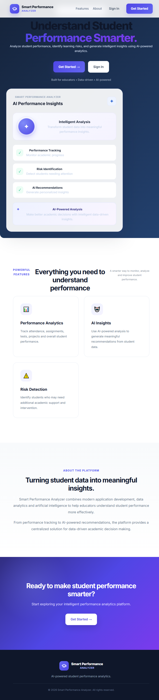

### Sign up
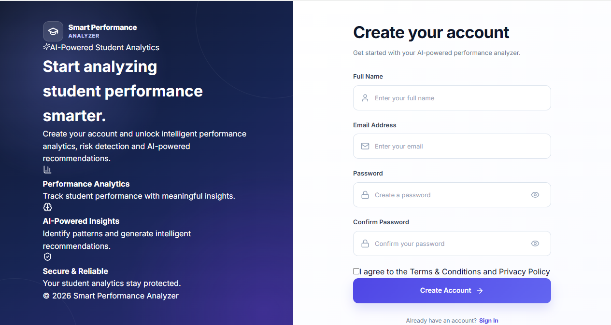

### Login
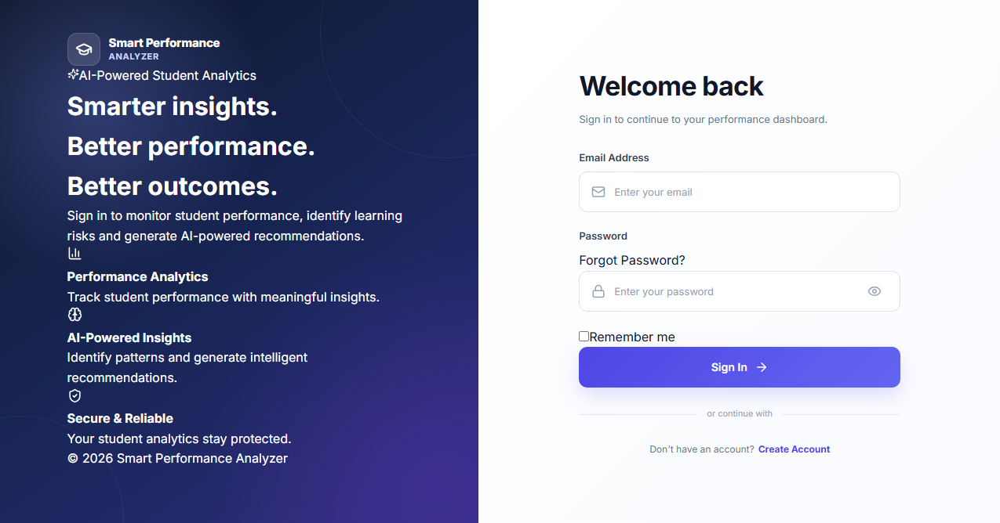

### Forgot password
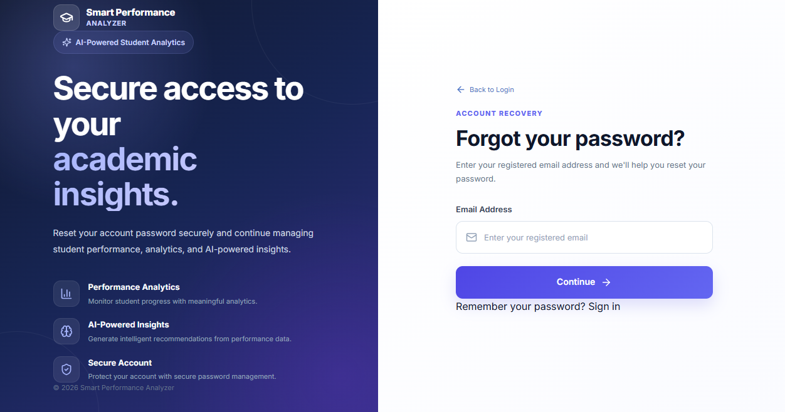

### Password recovery flow
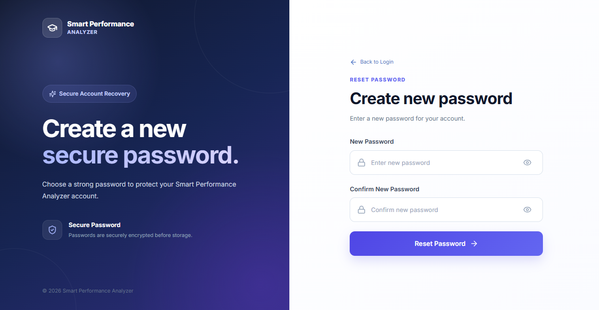

### Reset password
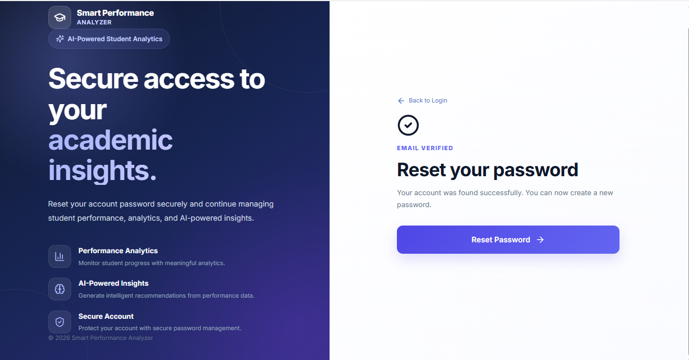

### Authenticated application
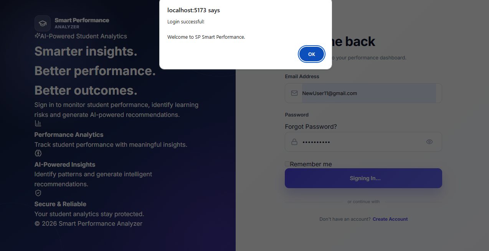

### Dashboard
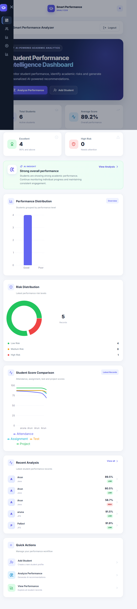

### Student management
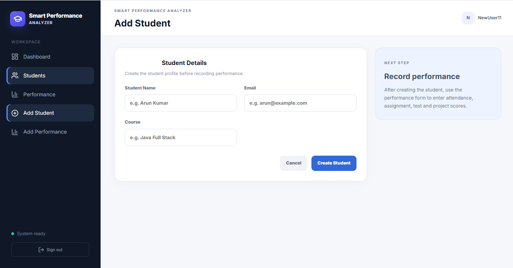

### Student list
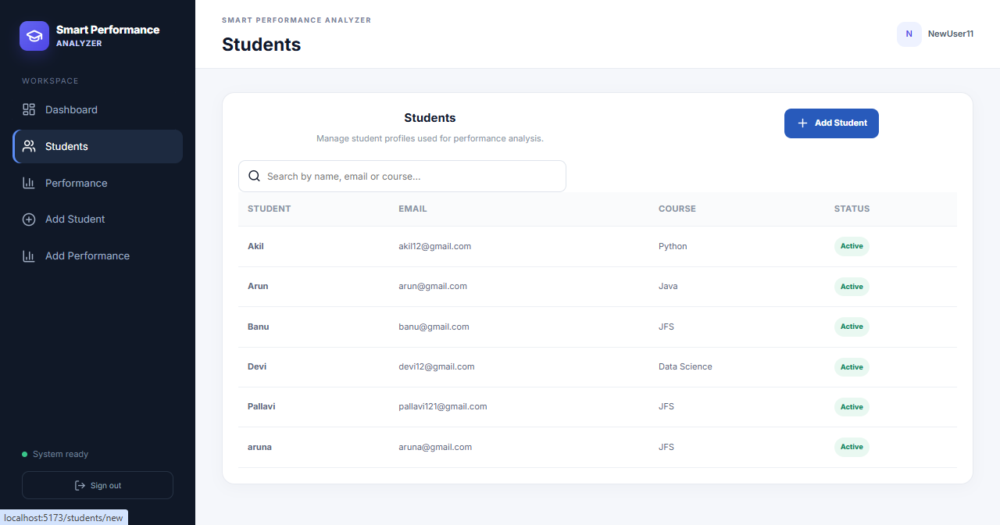

### Add performance
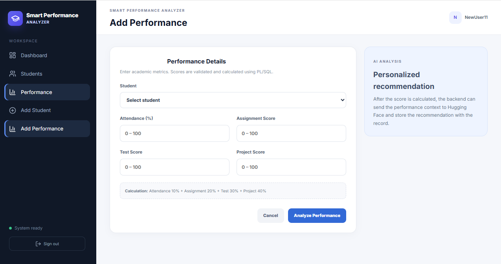

### AI recommendation
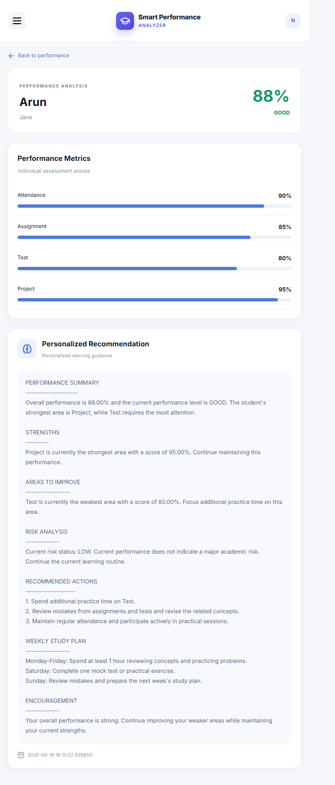

### Logout
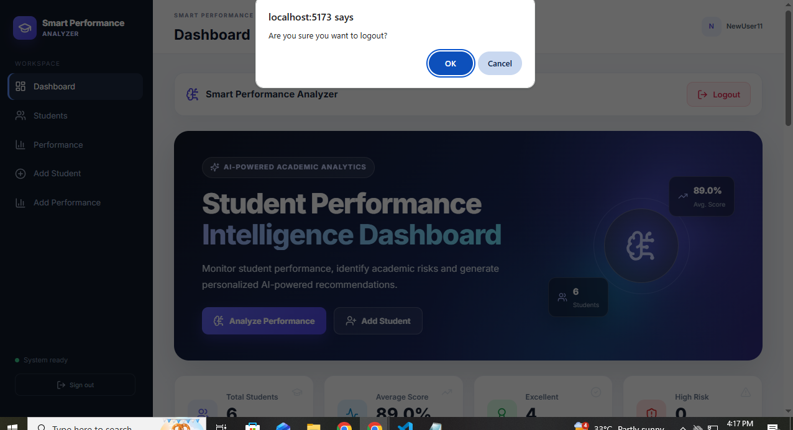

## Troubleshooting

### Backend cannot connect to Oracle
- Verify that Oracle is running and reachable.
- Check `DB_URL`, `DB_USERNAME`, and `DB_PASSWORD`.
- Confirm the service name/SID in the JDBC URL.
- Confirm that the required tables, sequences, triggers, view, and stored procedure exist in the schema used by the application.

### `calculate_performance` procedure not found
- Run the reviewed `database/03_procedure.sql` script in the correct schema.
- Confirm the procedure name and compilation status in Oracle.
- Check the backend database user has permission to execute it if it is owned by another schema.

### Frontend cannot reach the backend
- Confirm the backend is listening on port `8081` or update `VITE_API_BASE_URL`.
- Confirm the browser's request URL and backend CORS configuration.
- Restart the Vite development server after changing `.env`.

### AI recommendations use fallback text
- This is expected when `HF_ENABLED=false` or `HF_TOKEN` is empty.
- If AI is enabled, verify the token, endpoint, model identifier, network connectivity, and the provider's current API/model availability.
- The fallback is intended to let performance analysis continue when the external AI service fails.

### API returns `401` or `403`
- `401 Unauthorized` usually means the token is missing, expired, or invalid.
- `403 Forbidden` usually means the authenticated role does not have access to that endpoint.
- Sign in again and verify the account's role in the database.

### Database script reports SQL syntax errors
- Use an Oracle-compatible SQL client.
- Replace informal `//` comment lines with `--` comments where needed.
- Execute SQL scripts individually and inspect errors rather than assuming every statement succeeded.

## Security Notes

Before publishing or deploying:

1. **Never commit `.env` files.** Commit only `.env.example` files with placeholders.
2. **Rotate any credentials or API tokens that have ever been committed, shared, or included in an uploaded archive.** Removing a secret from the latest commit does not remove it from Git history.
3. Replace example JWT secrets with a strong, randomly generated secret stored outside source control.
4. Do not use real student personal or academic data in public demos.
5. Review password-reset behavior and connect it to a secure delivery channel before production use.
6. Review CORS, error responses, token lifetime, authorization rules, audit-log retention, and database privileges before deployment.
7. Avoid exposing SQL logs or sensitive exception details in production.
8. Review the use of `JPA_DDL_AUTO=update`; controlled database migrations are preferable for production.
9. Keep all AI provider credentials on the backend. Do not expose them through `VITE_` variables.

## Known Limitations

- AI recommendations depend on an external provider when enabled; the fallback recommendation is rule-based.
- Password recovery and temporary-password workflows should be reviewed and tested for the intended deployment environment.
- Database scripts may require review/cleanup for the particular Oracle version and SQL client.
- The repository does not include a full deployment pipeline or a production-ready secret-management setup.
- Automated tests and production hardening should be expanded before real-world use.
- Role assignment and student-account linking require correct database setup.

## Possible Enhancements

- Add automated unit, integration, and end-to-end tests.
- Add API documentation with OpenAPI/Swagger.
- Add pagination and filtering to larger student/performance lists.
- Add performance trend charts over time.
- Add email delivery and rate limiting for password recovery.
- Add database migrations with Flyway or Liquibase.
- Add Docker Compose for local frontend/backend/database-adjacent services.
- Add CI checks and cloud deployment.
- Improve audit coverage and configurable audit retention.

## Learning Outcomes

This project demonstrates practical work with:

- React frontend development and REST API integration.
- Spring Boot controller/service/repository architecture.
- Java DTOs, validation, and centralized exception handling.
- Spring Security, BCrypt, bearer tokens, and role-based access.
- Oracle SQL, PL/SQL procedures, sequences, triggers, indexes, and views.
- Calling stored procedures from Java with `JdbcTemplate`.
- AI API integration with a fallback path.
- Dashboard visualization, PDF generation, Excel exports, and audit logging.
- Environment-based application configuration.

## Author

**Keerthana D**

Software Trainer | AI & Software Mentor

Interested in Java backend development, full-stack development, cloud technologies, and AI-powered applications.

## License

No license file was identified in the reviewed project structure. If you intend to make the repository open source, add a `LICENSE` file and select a license that matches how you want others to use the code. Until then, do not assume that others have permission to reuse or redistribute it.
