# Smart Performance Analyzer

Smart Performance Analyzer is a full-stack web application designed to help educators track student performance and identify students who may need additional support.

The application allows users to manage student details, enter academic performance data, calculate an overall performance score, classify students based on their performance, and generate AI-based recommendations.

The project was built to practice and demonstrate real-world application development using **React, Spring Boot, Oracle, PL/SQL, REST APIs, JWT authentication, role-based access control, audit logging, and AI integration**.

---

## Project Overview

In a normal classroom environment, student performance data is often maintained manually using spreadsheets or separate records.

This can make it difficult to quickly identify:

* Students with low performance
* Students who are at academic risk
* Overall class performance
* Individual performance trends
* Areas where a student needs improvement

Smart Performance Analyzer brings these activities into one application.

A user can add students, enter their attendance and marks, and analyze the performance. The application calculates the performance using predefined business rules and can then generate an AI-based recommendation.

---

## Main Features

### User Authentication

* User signup
* User login
* Secure password storage using BCrypt
* Standard signed **JWT (HS256)** authentication
* Logout
* Forgot password
* Password reset
* Protected application pages
* Temporary password flow for admin-created trainers

### Role-Based Access Control (RBAC)

The application supports three roles: **Admin**, **Trainer** and **Student**.

* Roles are enforced on the backend using Spring Security, not only hidden in the user interface
* Public signup always creates a **Student** account; roles can never be chosen by the person signing up
* Admins create trainer accounts and receive a one-time temporary password for them
* A trainer must change the temporary password on first login
* Each role sees only the screens it is allowed to use

### Student Management

* Add new students
* View students
* Search students
* Update student information
* Deactivate and reactivate students
* Check duplicate email addresses

### Performance Management

The application stores:

* Attendance
* Assignment score
* Test score
* Project score

The overall performance is calculated automatically.

### Performance Classification

Based on the calculated score, students are classified into:

| Score      | Performance Level |
| ---------- | ----------------- |
| 90 - 100   | Excellent         |
| 75 - 89.99 | Good              |
| 60 - 74.99 | Average           |
| Below 60   | Poor              |

### Risk Identification

The application also identifies the student's risk level.

| Score      | Risk Status |
| ---------- | ----------- |
| 75 - 100   | Low         |
| 60 - 74.99 | Medium      |
| Below 60   | High        |

### AI Recommendation

After the performance is calculated, the application can send the structured performance result to an AI service.

The AI service generates a recommendation that can help the educator understand what kind of improvement the student may need.

A rule-based fallback recommendation is also available when the AI service is disabled or unavailable.

### Dashboard

The dashboard provides an overall view of student performance.

It displays information such as:

* Total students
* Average score
* Excellent students
* Good students
* Average students
* Poor students
* High-risk students

Charts are used to make the information easier to understand.

### Audit Logging

Important changes are recorded so that an administrator can review who did what and when.

* Records the actor, role, action, affected record, and the old and new values
* Also stores request details such as the IP address, HTTP method and path
* The audit entry is saved in the same transaction as the data change
* Admin-only audit log screen with paging

### Reports and Export

* PDF performance report for a single student
* Excel export of the dashboard summary
* Excel export of performance records
* Excel export of students

---

##The application now includes:
* Standard **JWT** authentication replacing the earlier custom token
* **Role-based access control** for Admin, Trainer and Student
* Admin management of trainer accounts, including temporary passwords
* A separate student portal for viewing personal performance
* **Audit logging** with an admin review screen
* **PDF and Excel** reports
* **Automated tests** (JUnit 5, Mockito, MockMvc)and a GitHub Actions pipeline

---

# Technology Stack

## Frontend

* React
* Vite
* JavaScript
* Axios
* Recharts
* HTML5
* CSS3

## Backend

* Java 17
* Spring Boot
* Spring Web
* Spring Data JPA
* Hibernate
* Spring Security
* JWT (JJWT library)
* BCrypt
* JdbcTemplate
* Jakarta Validation
* OpenPDF and Apache POI (PDF and Excel reports)
* Maven

## Database

* Oracle Database
* SQL
* PL/SQL
* Stored Procedure
* Database View
* Sequences
* Indexes

## AI

* Hugging Face API
* Rule-based fallback recommendation

## Testing and CI

* JUnit 5
* Mockito
* Spring MockMvc
* JaCoCo (coverage)
* GitHub Actions

---

# System Architecture

```text
                    React Frontend
                         |
                         | HTTP / REST API
                         |
                       Axios
                         |
                         v
                Spring Boot Backend
                         |
              +----------+----------+
              |                     |
              v                     v
        Spring Security          Controllers
        (JWT + RBAC)                |
              |                     v
              |                  Services
              |                     |
              |          +----------+----------+
              |          |                     |
              |          v                     v
              |       JPA/JDBC             AI Service
              |          |                     |
              |          v                     v
              |       Oracle DB          Hugging Face
              |          |
              |          v
              |       PL/SQL
              |
              v
     Bearer Token Filter
```

---

# Application Workflow

The main application flow is:

```text
User
  |
  v
Login
  |
  v
Dashboard (depends on role)
  |
  +----> Manage Students
  |
  +----> Add Performance
              |
              v
       Validate Input
              |
              v
      Calculate Performance
              |
              v
        Oracle PL/SQL
              |
              v
       Overall Score
              |
        +-----+------+
        |            |
        v            v
 Performance      Risk Status
   Level
        |
        v
 Save Performance
        |
        v
 AI Recommendation
        |
        v
 Save Recommendation
        |
        v
 Record Audit Log
        |
        v
 Display Result
```

---

# Performance Calculation

The overall score is calculated using a weighted formula.

```text
Overall Score =
(Attendance × 10%)
+ (Assignment × 20%)
+ (Test × 30%)
+ (Project × 40%)
```

For example, assume a student has:

```text
Attendance = 80
Assignment = 70
Test       = 75
Project    = 90
```

Calculation:

```text
80 × 10% = 8
70 × 20% = 14
75 × 30% = 22.5
90 × 40% = 36
```

Therefore:

```text
Overall Score = 8 + 14 + 22.5 + 36

Overall Score = 80.5
```

The student will therefore be classified as:

```text
Performance Level = GOOD
Risk Status       = LOW
```

The calculation is handled using a PL/SQL stored procedure rather than allowing the AI service to calculate the score.

This keeps the important business calculation deterministic and consistent.

---

# AI Recommendation Flow

AI is used after the performance calculation.

The application first calculates the student's actual performance using the defined business rules.

The structured result is then passed to the AI service.

```text
Student Performance
        |
        v
Oracle PL/SQL
        |
        v
Score + Level + Risk
        |
        v
AI Service
        |
        v
Hugging Face API
        |
        v
Recommendation
        |
        v
Store in Database
        |
        v
Display to User
```

For example, if a student has a low overall score and poor attendance, the AI can generate a recommendation focusing on attendance and the areas with lower scores.

The AI is therefore used for **recommendation generation**, not for the core performance calculation.

---

# AI Fallback

The application does not completely depend on the external AI API.

If:

* AI is disabled
* API token is missing
* Hugging Face is unavailable
* API request fails
* AI response is invalid

the application can generate a rule-based recommendation.

This allows the performance analysis feature to continue working even when the external AI service is not available.

---

# Database Design

The main database tables are:

### USERS

Stores application user account information, including the role and temporary-password settings.

```text
USERS
-----
user_id
full_name
email
password_hash
role                    (ADMIN / TRAINER / STUDENT)
must_change_password
password_expires_at
is_active
created_at
updated_at
```

### PASSWORD_RESET_TOKEN

Stores password reset information.

```text
PASSWORD_RESET_TOKEN
--------------------
token_id
user_id
reset_token
expiry_time
used
```

### STUDENT

Stores student information. A student record can be linked to one login account.

```text
STUDENT
-------
student_id
student_name
email
course
active
user_id                 (links to USERS, unique)
created_at
updated_at
```

### STUDENT_PERFORMANCE

Stores the performance details of each student.

```text
STUDENT_PERFORMANCE
-------------------
performance_id
student_id
attendance
assignment_score
test_score
project_score
overall_score
performance_level
risk_status
ai_recommendation
created_at
updated_at
```

### AUDIT_LOG

Stores the history of important actions.

```text
AUDIT_LOG
---------
log_id
actor_user_id
actor_name
actor_email
actor_role
action
entity_type
entity_id
description
old_value
new_value
ip_address
request_method
request_path
created_at
```

### Relationship

One student can have multiple performance records.

```text
STUDENT
   |
   | 1
   |
   | N
   v
STUDENT_PERFORMANCE
```

This represents a **one-to-many relationship**.

---

# PL/SQL

PL/SQL is used for the performance calculation.

The stored procedure receives the student's performance values and calculates:

* Overall score
* Performance level
* Risk status

The backend calls the procedure using `JdbcTemplate`.

This gives the project an example of integrating **Spring Boot with Oracle PL/SQL business logic**.

---

# Backend Architecture

The backend follows a layered structure.

```text
Controller
    |
    v
Service
    |
    v
Repository
    |
    v
Oracle Database
```

### Controller

Handles HTTP requests and responses.

Examples:

```text
StudentController
PerformanceController
AuthController
AdminUserController
StudentPortalController
AuditLogController
ReportController
```

### Service

Contains the application/business logic.

Examples:

```text
StudentService
PerformanceService
AuthService
AIService
AuditLogService
```

### Repository

Handles database operations using Spring Data JPA.

Examples:

```text
StudentRepository
PerformanceRepository
UserRepository
AuditLogRepository
```

### DTO

DTOs are used to control the data transferred between the frontend and backend.

Examples:

```text
StudentRequest
StudentResponse
PerformanceRequest
PerformanceResponse
DashboardResponse
ApiError
```

---

# Security

Spring Security is used to protect the application APIs.

The application includes:

* Password hashing using BCrypt
* Stateless authentication using signed **JWT (HS256)** tokens
* A bearer token filter that checks the token and the current user on every request
* **Role-based authorization** for Admin, Trainer and Student
* A restricted, short-lived (15-minute) `password_change` token used only to change a temporary password; it cannot access application data
* Temporary passwords that expire
* Public authentication endpoints and protected REST endpoints
* Request validation
* CORS configuration
* Audit logging of important data changes

Passwords are never stored as plain text.

### Access Rules

| Area                                  | Who can access                |
| ------------------------------------- | ----------------------------- |
| Signup, login, forgot/reset password  | Public                        |
| Change temporary password             | Temporary-password token only |
| Students, performance, reports        | Admin, Trainer                |
| Trainer management, audit logs        | Admin                         |
| Personal performance (student portal) | Student                       |

---

# Validation and Exception Handling

The backend validates incoming requests before processing them.

For example:

* Required fields
* Valid email format
* Score range (0 to 100)
* Duplicate student email
* Student existence

The application also uses centralized exception handling.

Main custom exceptions include:

```text
BadRequestException
DuplicateResourceException
ResourceNotFoundException
```

A global exception handler converts these exceptions into structured API responses.

---

# REST API

The backend exposes REST APIs for authentication, students, performance, reports, administration and audit logs.

### Authentication

| Method | Endpoint                              | Purpose                     |
| ------ | ------------------------------------- | --------------------------- |
| POST   | `/api/auth/signup`                    | Create a student account    |
| POST   | `/api/auth/login`                     | Login                       |
| POST   | `/api/auth/forgot-password`           | Request password reset      |
| POST   | `/api/auth/reset-password`            | Reset password              |
| POST   | `/api/auth/change-temporary-password` | Change a temporary password |

### Students (Admin, Trainer)

| Method | Endpoint                    | Purpose                          |
| ------ | --------------------------- | -------------------------------- |
| GET    | `/api/students`             | Get students (`status` filter)   |
| GET    | `/api/students/{id}`        | Get student                      |
| POST   | `/api/students`             | Add student                      |
| PATCH  | `/api/students/{id}/status` | Deactivate or reactivate student |

### Performance (Admin, Trainer)

| Method | Endpoint                     | Purpose                  |
| ------ | ---------------------------- | ------------------------ |
| GET    | `/api/performance`           | Get performance records  |
| GET    | `/api/performance/{id}`      | Get performance details  |
| POST   | `/api/performance`           | Add performance          |
| PUT    | `/api/performance/{id}`      | Update performance       |
| DELETE | `/api/performance/{id}`      | Delete performance       |
| GET    | `/api/performance/dashboard` | Get dashboard statistics |

### Reports (Admin, Trainer)

| Method | Endpoint                                            | Purpose                     |
| ------ | --------------------------------------------------- | --------------------------- |
| GET    | `/api/reports/students/{studentId}/performance.pdf` | Student performance PDF     |
| GET    | `/api/reports/dashboard.xlsx`                       | Dashboard summary (Excel)   |
| GET    | `/api/reports/performance.xlsx`                     | Performance records (Excel) |
| GET    | `/api/reports/students.xlsx`                        | Students list (Excel)       |

### Administration (Admin)

| Method | Endpoint                          | Purpose                          |
| ------ | --------------------------------- | -------------------------------- |
| POST   | `/api/admin/trainers`             | Create a trainer account         |
| GET    | `/api/admin/trainers`             | List trainers                    |
| PATCH  | `/api/admin/trainers/{id}/status` | Activate or deactivate a trainer |
| GET    | `/api/audit-logs?page=0&size=20`  | View audit logs (paged)          |

### Student Portal (Student)

| Method | Endpoint                      | Purpose                              |
| ------ | ----------------------------- | ------------------------------------ |
| GET    | `/api/student/me/performance` | View the logged-in student's results |

---

# Project Structure

```text
smart-performance-analyzer/
│
├── frontend/
│   ├── src/
│   │   ├── components/
│   │   ├── pages/
│   │   ├── services/
│   │   ├── App.jsx
│   │   ├── main.jsx
│   │   └── index.css
│   │
│   ├── .env.example
│   ├── package.json
│   └── vite.config.js
│
├── backend/
│   ├── src/
│   │   ├── main/
│   │   │   ├── java/
│   │   │   │   └── com/smartperformance/
│   │   │   │       ├── auth/
│   │   │   │       ├── config/
│   │   │   │       ├── controller/
│   │   │   │       ├── dto/
│   │   │   │       ├── entity/
│   │   │   │       ├── exception/
│   │   │   │       ├── report/
│   │   │   │       ├── repository/
│   │   │   │       └── service/
│   │   │   │
│   │   │   └── resources/
│   │   │       └── application.properties
│   │   │
│   │   └── test/
│   │       └── java/
│   │           └── com/smartperformance/
│   │
│   ├── .env.example
│   └── pom.xml
│
├── database/
│   ├── 00_auth_tables.sql
│   ├── 01_tables.sql
│   ├── 02_sequences_triggers_indexes.sql
│   ├── 03_procedure.sql
│   ├── 04_view.sql
│   ├── 005_audit_logs.sql
│   ├── 06_validation_queries.sql
│   ├── role-based-auth-migration.sql
│   └── student-user-link-migration.sql
│
├── Output_ScreenShots/
│
├── .github/
│   └── workflows/
│       └── ci.yml
│
├── .gitignore
├── README.md
└── LICENSE
```

---

# How to Run the Project

## Prerequisites

Install the following before running the project:

* Java 17
* Maven (or use the included Maven wrapper)
* Node.js
* npm
* Oracle Database
* Git

---

## 1. Clone the Repository

```bash
git clone <your-github-repository-url>
```

Move into the project:

```bash
cd smart-performance-analyzer
```

---

## 2. Configure Oracle Database

Create the required database objects using the SQL scripts inside the `database` folder.

Run the scripts in this order:

```text
00_auth_tables.sql
01_tables.sql
02_sequences_triggers_indexes.sql
03_procedure.sql
04_view.sql
student-user-link-migration.sql
005_audit_logs.sql
```

`role-based-auth-migration.sql` is only needed when upgrading an older database that was created before roles were added.

### Create the first Admin

Public signup always creates a Student account. To create the first administrator, sign up normally and then promote that account in Oracle:

```sql
UPDATE USERS SET ROLE = 'ADMIN' WHERE LOWER(EMAIL) = LOWER('your-admin-email@example.com');
COMMIT;
```

After that, the Admin can create Trainer accounts from the application.

---

## 3. Configure Backend

Create a local environment file from the example:

```bash
cd backend
cp .env.example .env
```

Then set your own values:

```text
SERVER_PORT=8081

DB_URL=your_oracle_database_url
DB_USERNAME=your_database_username
DB_PASSWORD=your_database_password

HF_ENABLED=false
HF_TOKEN=your_huggingface_token

JWT_SECRET=your_long_random_secret_key
JWT_EXPIRATION_MS=86400000
```

Use a long random value for `JWT_SECRET` (at least 32 characters).

Set `HF_ENABLED=true` and add a token only if you want AI-generated recommendations. Otherwise the rule-based fallback is used.

Do not commit actual passwords, API tokens or secret keys to GitHub.

---

## 4. Start the Backend

Open the backend folder:

```bash
cd backend
```

Run:

```bash
mvn spring-boot:run
```

or

```bash
./mvnw spring-boot:run
```

The backend will start on the configured port (default `8081`).

---

## 5. Start the Frontend

Open another terminal:

```bash
cd frontend
```

Install dependencies:

```bash
npm install
```

Start the development server:

```bash
npm run dev
```

Open the URL shown by Vite in the terminal.

---

# Configuration

The frontend uses an environment variable for the backend URL.

Example:

```text
VITE_API_BASE_URL=http://localhost:8081/api
```

The backend contains configuration for:

* Oracle database
* JWT authentication (secret and expiry)
* AI service
* Application port

Environment files containing real credentials should not be pushed to GitHub.

---

# Testing

The backend includes automated tests that run **without an Oracle database**, so they can run on any machine and in CI.

What is covered:

* **JWT logic** – token creation, parsing, tampered or wrongly signed tokens, and the 15-minute limit on password-change tokens
* **Role-based security** – the real security filter chain checked with MockMvc: no token returns 401, a Student token returns 403, Trainer and Admin tokens are allowed, and a password-change token cannot reach application data
* **Request validation** – out-of-range scores return 400
* **Performance service** – the PL/SQL result is applied, inactive or unknown students are rejected, and audit entries are written for create, update and delete
* **AI fallback** – recommendations are still produced when AI is disabled, has no token, or receives missing scores

Run the tests:

```bash
cd backend
./mvnw test          # Mac / Linux
mvnw.cmd test        # Windows
```

The JaCoCo coverage report is generated at:

```text
backend/target/site/jacoco/index.html
```

### Continuous Integration

A GitHub Actions workflow (`.github/workflows/ci.yml`) runs the tests on every push and pull request and uploads the coverage report.

---

# Screenshots

Screenshots of the application.

## Landing Page

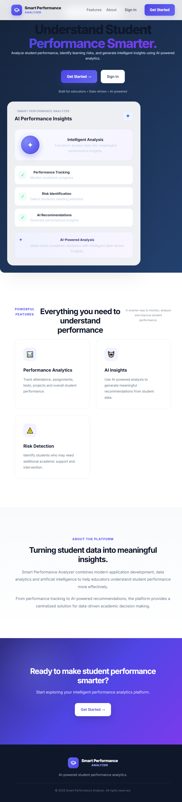

## SignUp

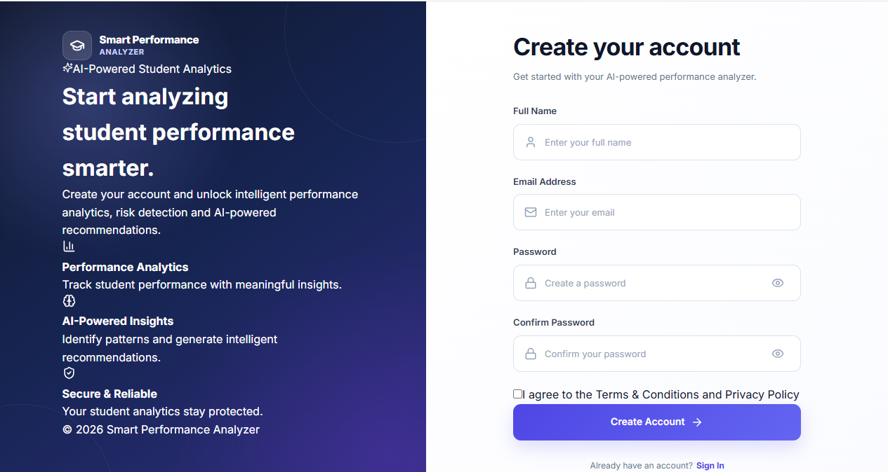

## Login

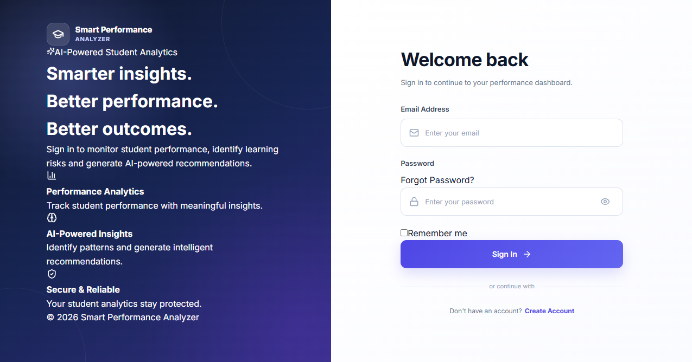

## ForgotPassword

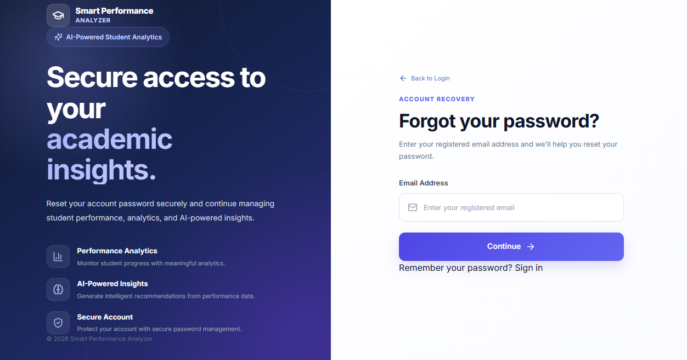

## CreateNewPassword

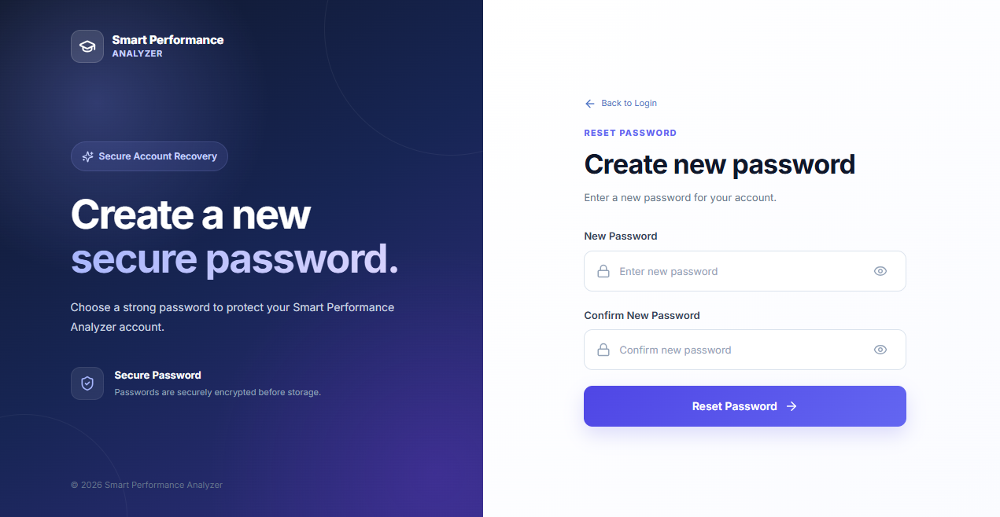

## ResetPassword

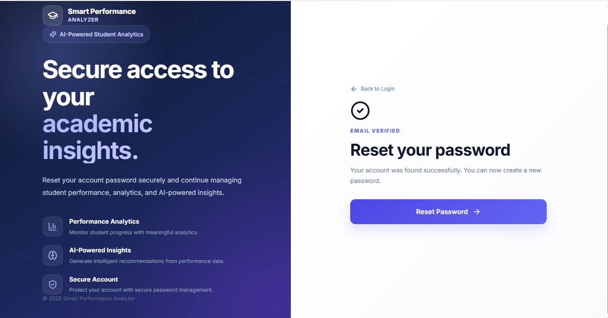

## Authenticated

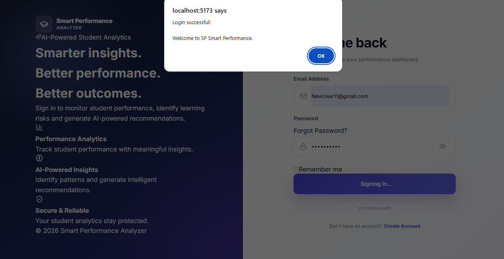

## Dashboard

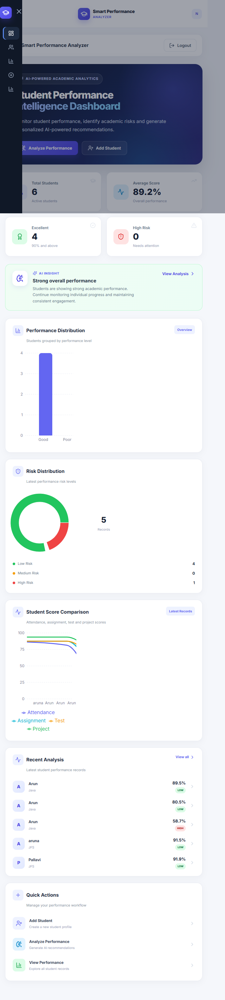

## Student Management

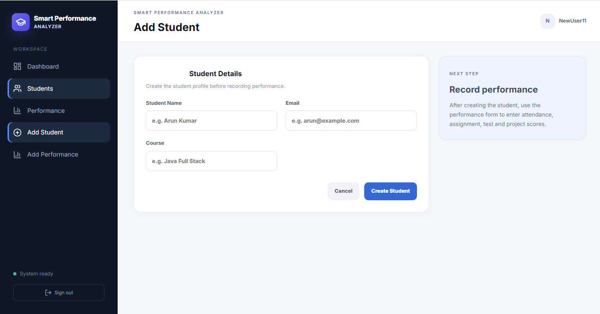

## Student List

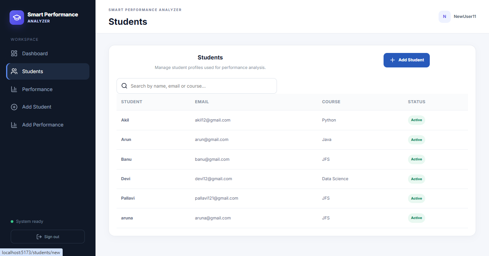

## Add Performance

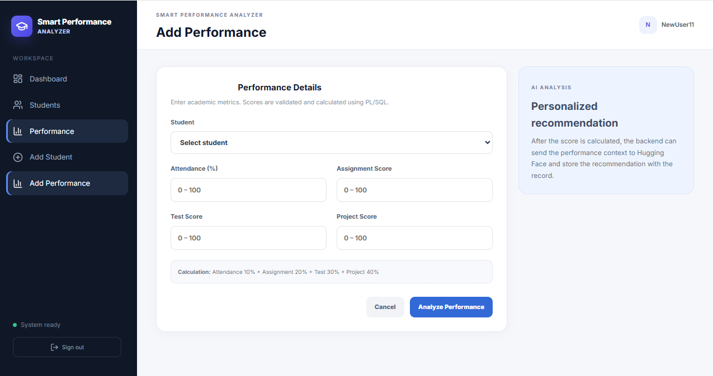

## AI Recommendation

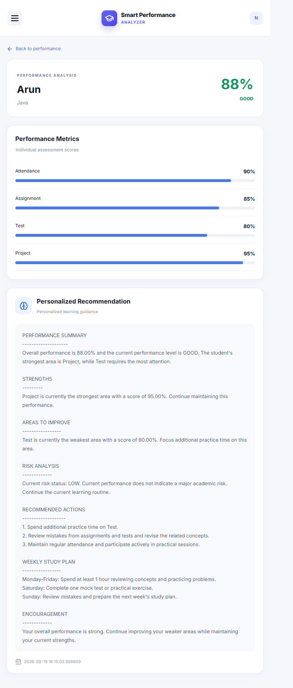

## Logout

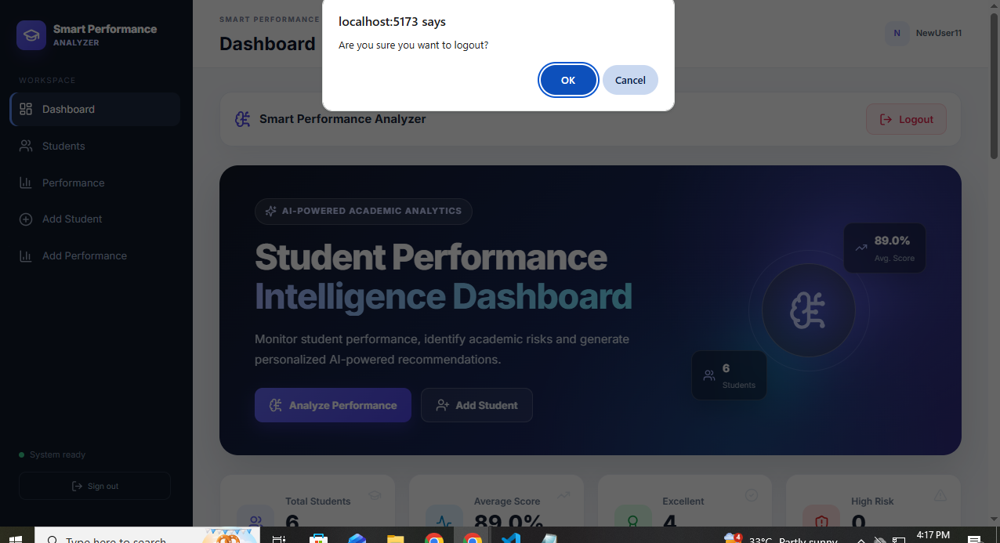

---

# What I Learned From This Project

This project helped me work with different parts of a real-world full-stack application instead of focusing on only one technology.

Some of the main areas I worked with are:

* Building REST APIs using Spring Boot
* Designing controller, service and repository layers
* Using Spring Data JPA with Oracle
* Calling PL/SQL from Java
* Implementing JWT authentication and password security
* Designing role-based access control and enforcing it on the backend
* Building a temporary-password flow with a restricted token
* Recording audit logs inside the same transaction as the data change
* Working with DTOs and request validation
* Handling exceptions globally
* Connecting React with REST APIs using Axios
* Creating dashboard charts
* Generating PDF and Excel reports
* Integrating an external AI API
* Designing an AI fallback mechanism
* Writing unit and security tests with JUnit, Mockito and MockMvc
* Setting up a CI pipeline with GitHub Actions
* Managing environment variables and application configuration

---

# Current Limitations

This project is currently designed as a portfolio and learning project.

Some areas can be improved further for a production deployment:

* Password reset can be connected to an actual email service.
* Authentication can be extended with refresh tokens or OAuth2.
* Trainer access is role-based; it is not yet limited to the students assigned to each trainer.
* More detailed student performance history can be added.
* More advanced analytics can be added to the dashboard.
* Test coverage can be expanded further, including integration tests against Oracle and frontend tests.
* Database schema changes can be managed with a migration tool instead of manual SQL scripts.
* The application can be containerized using Docker.
* Deployment can be added using a cloud platform.

---

# Future Enhancements

Some features planned for future versions include:

* Student performance trend analysis
* More detailed analytics
* Per-trainer student assignment
* Email notifications
* Automated monthly performance reports
* Attendance trend analysis
* Improved AI recommendations
* Docker deployment
* Cloud deployment

---

# Project Highlights

The main technical areas demonstrated by this project are:

```text
React
   +
Spring Boot
   +
REST API
   +
Spring Security (JWT + RBAC)
   +
Spring Data JPA
   +
Oracle
   +
PL/SQL
   +
Audit Logging
   +
AI API Integration
   +
Automated Testing + CI
```

One of the important parts of the project is the separation between **business calculation and AI processing**.

The application first uses predefined business rules and PL/SQL to calculate the actual performance. AI is then used to generate a more meaningful recommendation based on the calculated result.

---

# Author

Keerthana D

Software Trainer | AI & Software Mentor

Interested in Java Backend Development, Full-Stack Development and AI-based applications.

---

# License

This project is created for learning, portfolio and demonstration purposes.
